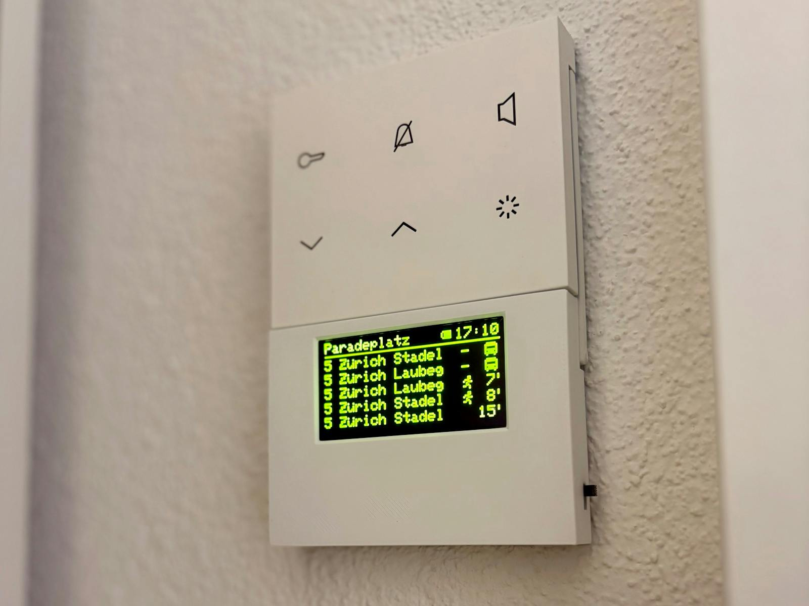
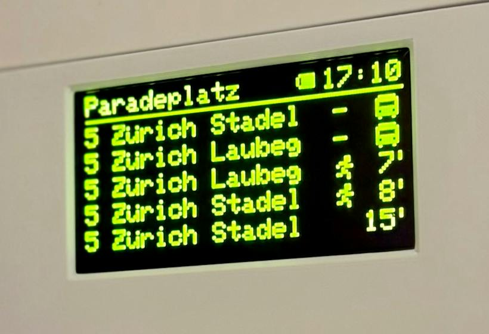

# ZH Tram Departure Board

[](https://opensource.org/licenses/MIT)
[](https://www.espressif.com/en/products/socs/esp32-c6)
[](https://www.arduino.cc/)

A battery-powered departure display for Zurich public transport using an ESP32-C6 and OLED screen.



## In use



The finished board and a detail crop of its departure display. Photo from
[my Hackster build article](https://www.hackster.io/supertoub/tram-departure-board-1fcd47).

## Features

- **Real-time departures** from the Swiss public transport API
- **Offline mode** with pre-loaded GTFS schedules when WiFi is unavailable
- **Battery powered** with voltage monitoring and display
- **Deep sleep** mode for minimal power consumption
- **Toggle switch** for instant sleep/wake control
- **Automatic display switching** between multiple lines

## Quick Start

### 1. Clone and configure

```bash
git clone https://github.com/tobiasweissert/zh-tram-departure-board.git
cd zh-tram-departure-board
cp firmware/zh_tram_departure_board/Config.example.h firmware/zh_tram_departure_board/Config.h
# Edit Config.h with your WiFi credentials
```

### 2. Install dependencies

```bash
arduino-cli core install esp32:esp32
arduino-cli lib install "Adafruit GFX Library" "Adafruit SSD1306" "ArduinoJson"
```

### 3. Build and upload

```bash
arduino-cli compile --fqbn esp32:esp32:esp32c6 firmware/zh_tram_departure_board
arduino-cli upload -p /dev/cu.usbmodem* --fqbn esp32:esp32:esp32c6 firmware/zh_tram_departure_board
```

## Hardware

| Component | Model |
|-----------|-------|
| Microcontroller | Seeed Studio XIAO ESP32-C6 |
| Display | 128x64 OLED SSD1306 (SPI) |
| Power switch | SPST toggle switch |
| Battery | 3.7V LiPo (optional) |

See [hardware/wiring.md](hardware/wiring.md) for detailed wiring instructions.

## Project Structure

```
zh-tram-departure-board/
├── firmware/
│   ├── zh_tram_departure_board/ # Arduino sketch
│   │   ├── zh_tram_departure_board.ino # Main program
│   │   ├── Config.h          # Your settings (gitignored)
│   │   ├── Config.example.h  # Template for Config.h
│   │   ├── PowerManager.*    # Sleep/wake handling
│   │   ├── Display.*         # OLED rendering
│   │   ├── NetworkManager.*  # WiFi and API
│   │   ├── BatteryMonitor.*  # Battery ADC reading
│   │   ├── OfflineSchedule.* # Fallback schedules
│   │   ├── DataStructures.h  # Data types
│   │   ├── ScheduleData.h    # GTFS schedule data
│   │   ├── Icons.h           # Display icons
│   │   └── Utils.*           # Time formatting, NVS
│   └── sketch.json
├── tools/
│   └── generate_schedules.py     # GTFS schedule generator
├── hardware/
│   └── wiring.md                 # Wiring diagrams
├── enclosure/
│   └── README.md                 # 3D print files
├── docs/
│   ├── assembly.md               # Build instructions
│   ├── programming-guide.md      # Compile & upload
│   └── configuration.md          # Settings guide
├── LICENSE
└── README.md
```

## Operation

- **Switch open**: Device runs, fetches departures every 30 seconds
- **Switch closed**: Device enters deep sleep (minimal power draw)
- Display alternates between configured lines every 10 seconds
- Shows "!" indicator when using cached schedules (no WiFi)

## Customization

To use with different stations or transit lines, see the [configuration guide](docs/configuration.md).

## Data Sources

- Real-time: [transport.opendata.ch](https://transport.opendata.ch)
- GTFS schedules: [opentransportdata.swiss](https://opentransportdata.swiss)

## License

[MIT](LICENSE)
